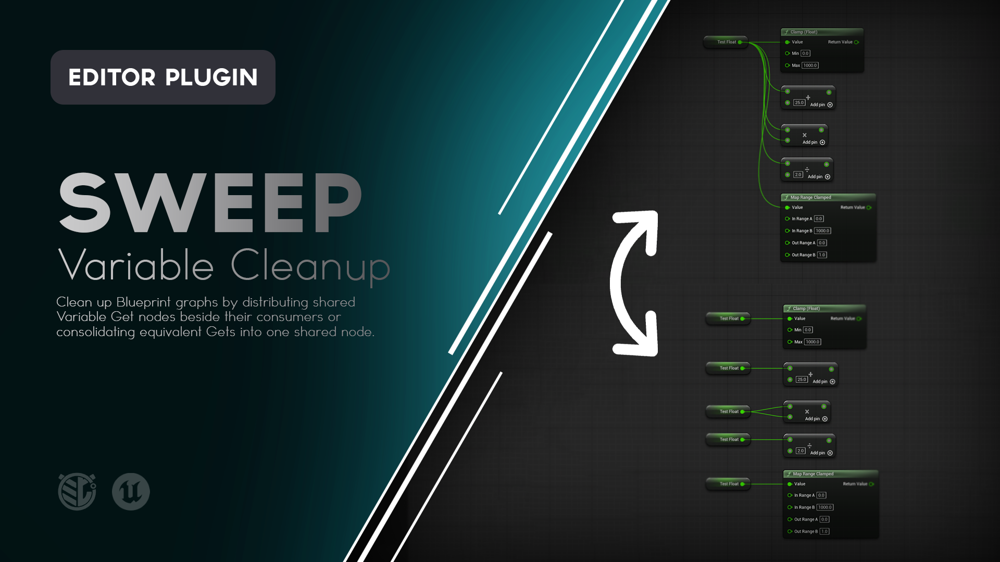
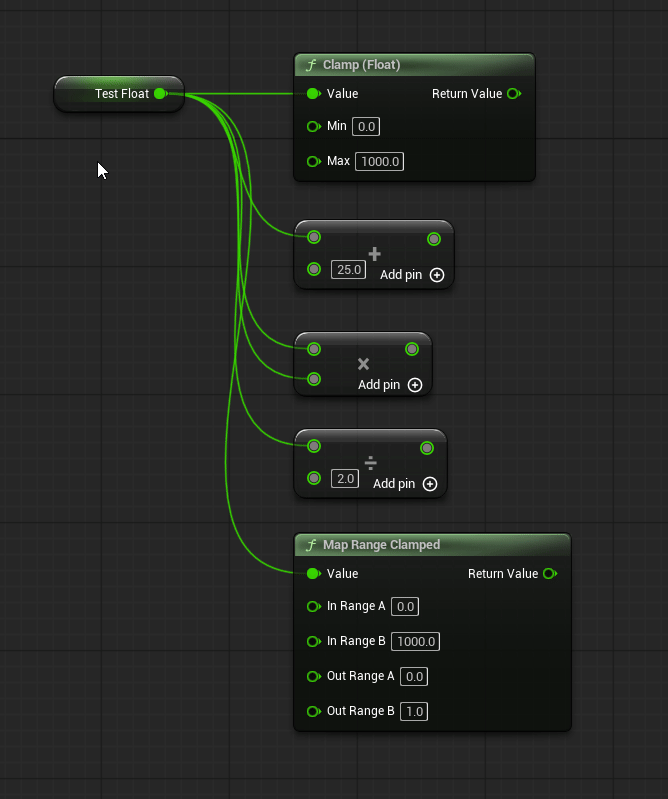
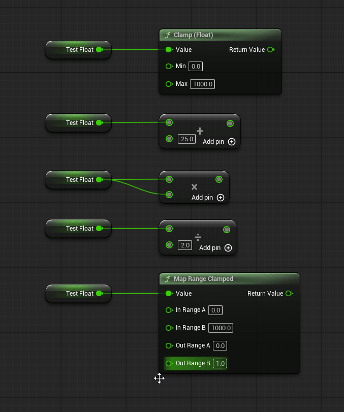

# Sweep

**Blueprint Variable Get Refactoring for Unreal Engine**

**Spend less time untangling wires. Spend more time building your Blueprints.**

Sweep brings two focused refactoring actions directly into Unreal Engine's **Blueprint graph context menu**. Distribute a shared Variable Get into local reads beside its consumers, or consolidate equivalent Gets into one chosen source—without manually recreating nodes and reconnecting all their wires.

    

  

---

## Blueprint graphs should be easier to read

A single Variable Get can feed calculations scattered across a Blueprint. The logic works, but long wires run through unrelated sections of the graph. At the other extreme, duplicating the same Get everywhere makes a graph crowded. Switching between those two layouts by hand means recreating nodes and reconnecting pins.

**Sweep lets you choose the clearer arrangement for each part of your graph.**

- **Bring values closer to their consumers.** Distribute one shared Get into local copies near the nodes that use it.
- **Reduce repeated nodes.** Consolidate equivalent selected Gets into the specific Get you want to keep.
- **Keep existing wire routes where appropriate.** Consolidation preserves reroutes; distribution follows reroutes to real consumers and removes only those left unused.
- **Clean up several Gets at once.** Batch-distribute eligible selected sources in a single Undo transaction.
- **Stay inside the Blueprint Editor.** No separate tool window, custom asset or runtime gameplay system.

## Explore the documentation

> ### [**Sweep Documentation — Full User Guide and Technical Reference**](https://mippi-the-dork.github.io/Sweep/)
>
> **Everything you need to learn and use Sweep, in one place.** See how each refactor behaves, follow practical graph examples, understand node equivalence and reroutes, and find installation instructions, implementation details and troubleshooting guidance.
>
> **[Get Started](https://mippi-the-dork.github.io/Sweep/?page=01-getting-started%2FREADME.md)** · **[Operations](https://mippi-the-dork.github.io/Sweep/?page=02-operations%2FREADME.md)** · **[Graph Integrity](https://mippi-the-dork.github.io/Sweep/?page=03-graph-integrity%2FREADME.md)** · **[Troubleshooting](https://mippi-the-dork.github.io/Sweep/?page=05-support%2FREADME.md)**

The README is an overview of what Sweep offers. **The [documentation website](https://mippi-the-dork.github.io/Sweep/) is the maintained reference for exact behavior, installation, workflows and technical details.**

## Two operations. One cleaner graph.

| Operation | What you can do |
| --- | --- |
| **[Distribute Variable Gets](https://mippi-the-dork.github.io/Sweep/?page=02-operations%2Fdistribute%2FDESIGN.md)** | Replace long shared value wires with local Gets placed near their destination nodes. |
| **[Consolidate Variable Gets](https://mippi-the-dork.github.io/Sweep/?page=02-operations%2Fconsolidate%2FDESIGN.md)** | Combine equivalent selected Gets into the right-clicked survivor while retaining its location and outgoing reroute paths. |
| **[Batch Distribution](https://mippi-the-dork.github.io/Sweep/?page=02-operations%2Fmulti-selection%2FDESIGN.md)** | Refactor several eligible selected Variable Gets together, with one Undo transaction. |

Sweep follows reroute chains to the actual consuming pins, creates **one local Get per destination node**, and uses Unreal's native Blueprint schema for reconnections. Consolidation checks the underlying variable reference and input context, not just the displayed name.

## Useful in real Blueprint workflows

### Untangle long shared value wires

When one Get stretches across unrelated calculations, Distribute creates local copies beside the consumers. Your existing nodes stay where they are; only the relevant Gets, links and unused reroutes are changed.

  

### Reduce repetitive Variable Gets

When several Gets read the same underlying variable from equivalent contexts, Consolidate connects their consumers to the Get you right-click. That Get stays in place, and existing reroute paths remain.

  

### Clean up several sources in one pass

Select several eligible Gets and use **Distribute Selected Variable Gets** to clean up multiple wiring problems together. Sweep tracks the selection before Unreal opens the context menu, helping preserve the intended batch even when the visible selection changes.

  

### Make changes without rebuilding the graph

Sweep uses native editor transactions for Undo and Redo, and places new Gets near the destination inputs without moving unrelated nodes. The placement is best effort rather than a full automatic graph layout.

[**Explore reroute handling, equivalence, placement and Undo →**](https://mippi-the-dork.github.io/Sweep/?page=03-graph-integrity%2FREADME.md)

## Get Sweep

**Sweep v1.0.0** targets **Unreal Engine 5.8.0–5.8.3 on Windows 64-bit** and runs in the **Editor only**.

Use a compatible GitHub release, install through Fab if Sweep is available in your library, or build the plugin from the source in this repository.

**[Download GitHub Releases](https://github.com/mippi-the-dork/Sweep/releases)** · **[Installation Guide](https://mippi-the-dork.github.io/Sweep/?page=01-getting-started%2Finstall%2FDESIGN.md)** · **[First Refactor](https://mippi-the-dork.github.io/Sweep/?page=01-getting-started%2Ffirst-use%2FDESIGN.md)**

## Important limitations

Sweep is a **focused Blueprint authoring utility**, not a general-purpose graph optimizer or runtime system.

- **Pure Variable Gets in K2 graphs only.** It does not distribute arbitrary pure functions, Variable Set nodes or execution-pin logic, and does not operate in Material, Niagara, MetaSound or other graph editors.
- **Distribute needs at least two terminal consuming inputs.** Reroutes are followed to the actual consumers; reroute nodes alone do not satisfy the requirement.
- **Consolidation requires equivalent variables and contexts.** Two Gets with the same visible name but different variable references or target objects are intentionally not merged. The right-clicked Get must be included in the selection.
- **Placement is best effort.** Sweep estimates node positions, checks nearby nodes and tries alternate locations, but may need manual spacing in crowded graphs. It does not move unrelated nodes.
- **Native graph validation still matters.** Connection changes use Unreal's K2 schema. In rare failure cases, consolidation attempts to restore a failed source's links, but a multi-source batch is not guaranteed to be all-or-nothing before Undo.
- **Compile and test important Blueprints.** Sweep is designed to preserve the intended variable reads, but it is not a formal proof that every refactored Blueprint behaves identically.
- **No packaged-game Sweep runtime.** The plugin itself does not add runtime systems or components; the edited Blueprint remains ordinary Blueprint data.

For details, see [FAQ and limitations](https://mippi-the-dork.github.io/Sweep/?page=05-support%2Ffaq%2FDESIGN.md) and [Troubleshooting](https://mippi-the-dork.github.io/Sweep/?page=05-support%2Ftroubleshooting%2FDESIGN.md).

## What's next?

**Sweep v1.0.0** established Distribute, Consolidate, multi-selection and reroute-aware Variable Get refactoring.

Potential future research includes additional safe refactor types, clearer eligibility diagnostics, more placement control and deeper validation. **These are possibilities, not announced features or committed release plans.**

[**View the Sweep Roadmap →**](https://mippi-the-dork.github.io/Sweep/?page=ROADMAP.md)

## Issues, feature requests and contributions

Found a bug? Please [open an issue](https://github.com/mippi-the-dork/Sweep/issues) with your Sweep/Unreal versions, the Blueprint graph type, the operation used, selected Gets, variable/target context, and steps to reproduce. Before-and-after screenshots, a short GIF or relevant Blueprint compiler output are especially helpful.

Have an idea? [Submit a feature request](https://github.com/mippi-the-dork/Sweep/issues) describing the graph readability problem and the result you'd like to achieve.

**Pull requests are welcome.** For major graph transformations, open an issue first so eligibility, connection safety, failure handling and scope can be discussed. Sweep aims to remain narrow, predictable and native to Unreal's existing Blueprint workflow.

## License

Sweep is distributed under the **MIT License**. See [LICENSE](LICENSE) for the full terms.

---

**Sweep is created by Mippi the Dork.**

**[Explore the Documentation](https://mippi-the-dork.github.io/Sweep/)** · **[Get Sweep](https://github.com/mippi-the-dork/Sweep/releases)** · **[Report an Issue](https://github.com/mippi-the-dork/Sweep/issues)**
