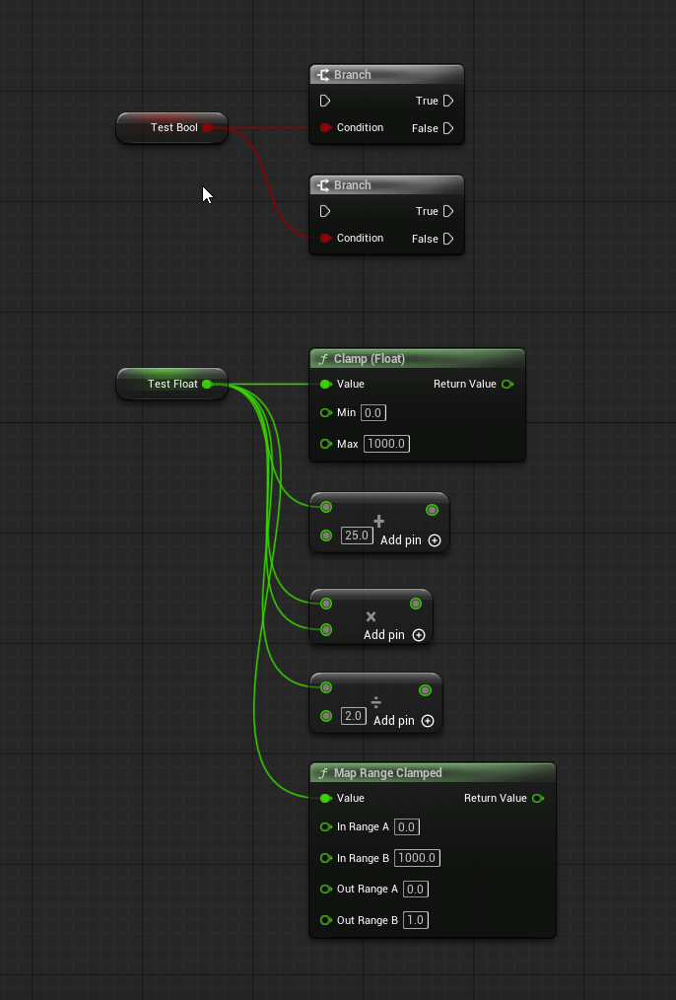

# Sweep

**Cleaner Blueprint graphs. Fewer long wires. Less manual cleanup.**

When one Blueprint Variable Get feeds calculations across a large graph, the wires can become harder to follow than the logic itself. Creating local Gets by hand is tedious; reconnecting repeated Gets to a shared source is just as repetitive.

**Sweep gives you both options, directly in Unreal Engine's Blueprint Editor.** Distribute a shared Variable Get into local copies beside its consumers, or consolidate equivalent Gets back into a single chosen node—all without manually rebuilding the connections.

### 📖 [Explore the complete Sweep documentation](https://mippi-the-dork.github.io/Sweep/)

**Installation, step-by-step guides, behavior details, technical references, troubleshooting, and the roadmap** all live on the dedicated [Sweep documentation website](https://mippi-the-dork.github.io/Sweep/). This README introduces the plugin and helps you decide whether it belongs in your workflow; the documentation is the source for learning exactly how to use it.

[**Get started**](https://mippi-the-dork.github.io/Sweep/?page=01-getting-started%2Ffirst-use%2FDESIGN.md) · [**Installation & compatibility**](https://mippi-the-dork.github.io/Sweep/?page=01-getting-started%2Finstall%2FDESIGN.md) · [**All operations**](https://mippi-the-dork.github.io/Sweep/?page=02-operations%2FREADME.md)

---

## Two ways to make a Blueprint easier to read

### Distribute — bring the value closer to where it's used

One Variable Get stretched across a graph can become a web of long, crossing wires. **Distribute** creates matching local Gets near the consumer nodes, reconnects their inputs, and removes source-reachable reroutes that are genuinely unused.

Sweep creates **one replacement Get per destination node**, even if that node uses the value on several inputs. It positions new Gets near their consumers without moving the rest of your graph.

**A good fit for:** large Event Graphs, widely reused state, and any Blueprint where long value wires obscure otherwise straightforward calculations.

[See how Distribute works](https://mippi-the-dork.github.io/Sweep/?page=02-operations%2Fdistribute%2FDESIGN.md)

### Consolidate — fewer copies, one shared source

Sometimes the opposite is clearer: the graph has too many repeated Gets for the same value. **Consolidate** merges equivalent selected Gets into **the one you right-click**, retaining that node and its position while transferring the others' outgoing connections.

Consolidation preserves existing reroute paths. It also checks the **actual variable reference and input context**, rather than trusting matching node names. Gets reading different target objects are not considered equivalent.

**A good fit for:** tightly related calculations where repeated Gets add clutter, or when you want a single shared read without manually reconstructing its wires.

[See how Consolidate works](https://mippi-the-dork.github.io/Sweep/?page=02-operations%2Fconsolidate%2FDESIGN.md)

---

## Small tool. Useful details.

| Feature | What it means for your workflow |
| --- | --- |
| **Batch distribution** | Select several eligible Gets and clean up their long connections in one operation. |
| **Reroute awareness** | Distribute follows reroutes to real consumers and removes only orphaned reachable reroutes; Consolidate keeps existing reroute topology. |
| **Context-aware consolidation** | Matching names aren't enough: the variable and the input context must actually be equivalent. |
| **Destination-based placement** | New Gets are positioned near consuming nodes with best-effort overlap avoidance; existing nodes aren't moved. |
| **One-step Undo / Redo** | Each refactor, including an eligible batch, is recorded as a single Unreal Editor transaction. |
| **Native workflow** | Commands appear in the Blueprint node's context menu. No new asset type or separate editor window. |
| **Editor-only** | No Sweep runtime module, gameplay component, or additional packaged-game dependency. |

[Learn about batch operations](https://mippi-the-dork.github.io/Sweep/?page=02-operations%2Fmulti-selection%2FDESIGN.md) · [Understand reroute behavior](https://mippi-the-dork.github.io/Sweep/?page=03-graph-integrity%2Freroutes%2FDESIGN.md) · [Learn the equivalence rules](https://mippi-the-dork.github.io/Sweep/?page=03-graph-integrity%2Fequivalence%2FDESIGN.md)

## Built for focused Blueprint cleanup

Sweep is deliberately **not** a full graph auto-layout or automatic logic optimizer. Its v1.0.0 scope is **pure Variable Get nodes in Blueprint K2 graphs**.

In particular, Sweep does **not**:

- Rewrite arbitrary pure function nodes, execution logic, or Variable Set nodes.
- Rearrange unrelated existing graph nodes or guarantee perfect placement in crowded graphs.
- Modify variable declarations or provide a new runtime gameplay system.
- Operate on Material, Niagara, MetaSound, Behavior Tree, or other non-K2 graph editors.
- Offer Distribute when a Get has fewer than **two terminal consuming inputs**.
- Consolidate Gets that reference different underlying variables or have different input/target contexts.

The operations are designed to preserve graph behavior, but a graph refactor is still an edit: **review the result and compile and test important Blueprints.**

[Full limitations and FAQs](https://mippi-the-dork.github.io/Sweep/?page=05-support%2Ffaq%2FDESIGN.md) · [Graph integrity and Undo](https://mippi-the-dork.github.io/Sweep/?page=03-graph-integrity%2FREADME.md)

## Download and compatibility

| | |
| --- | --- |
| **Current version** | Sweep v1.0.0 |
| **Unreal Engine** | 5.8.0–5.8.3 |
| **Platform** | Windows 64-bit |
| **Module** | Editor-only |
| **Runtime dependency** | None |

**[GitHub Releases](https://github.com/mippi-the-dork/Sweep/releases)** · **[Source code](https://github.com/mippi-the-dork/Sweep)** · **[Installation guide](https://mippi-the-dork.github.io/Sweep/?page=01-getting-started%2Finstall%2FDESIGN.md)**

If Sweep is available in your Fab library, it can also be installed through the Epic Games Launcher. Availability and compatible engine builds should be checked before installation.

---

## Documentation

Want to know exactly which nodes can be consolidated, how reroutes are handled, or why a command isn't appearing? **The dedicated documentation site is the place to look.**

| Documentation | What you'll find |
| --- | --- |
| **[Documentation Home](https://mippi-the-dork.github.io/Sweep/)** | Full manual and navigation |
| [Getting Started](https://mippi-the-dork.github.io/Sweep/?page=01-getting-started%2FREADME.md) | Installing Sweep and your first refactor |
| [Operations](https://mippi-the-dork.github.io/Sweep/?page=02-operations%2FREADME.md) | Distribute, Consolidate, batch selection, and when to use each |
| [Graph Integrity](https://mippi-the-dork.github.io/Sweep/?page=03-graph-integrity%2FREADME.md) | Reroutes, variable equivalence, placement, safe reconnection, and Undo |
| [Implementation](https://mippi-the-dork.github.io/Sweep/?page=04-implementation%2FREADME.md) | Source architecture and native Unreal Editor integration |
| [Troubleshooting](https://mippi-the-dork.github.io/Sweep/?page=05-support%2Ftroubleshooting%2FDESIGN.md) | Missing commands, unexpected placement, and recovery |
| [Roadmap](https://mippi-the-dork.github.io/Sweep/?page=ROADMAP.md) | Current release and possible future directions |

## Reporting issues

Found an unexpected result, a broken connection, or a missing menu command? **[Open a GitHub Issue](https://github.com/mippi-the-dork/Sweep/issues)**.

A useful report includes your Sweep/Unreal versions, the Blueprint graph type, whether you were distributing or consolidating, selected nodes, variable and target context, and steps to reproduce. **Before-and-after screenshots or a short recording** are especially helpful; include relevant Blueprint compiler errors or Output Log entries.

Check the [troubleshooting guide](https://mippi-the-dork.github.io/Sweep/?page=05-support%2Ftroubleshooting%2FDESIGN.md) for common eligibility and selection issues first.

## Feature requests

Have an idea that would make Blueprint graphs easier to work with? Share it through **[GitHub Issues](https://github.com/mippi-the-dork/Sweep/issues)**.

Describe the **graph problem you're trying to solve** and the before/after result you'd find useful. Sweep intentionally favors focused, predictable transformations over unrestricted graph rewriting; new operations need clear safety and behavior-preservation rules.

See the [Roadmap](https://mippi-the-dork.github.io/Sweep/?page=ROADMAP.md) for current scope and uncommitted research ideas.

## Contributing

**Contributions and pull requests are welcome.** For significant new transformations, open an Issue first to discuss supported node types, variable/context equivalence, connection behavior, Undo/Redo, and the required tests.

[Explore the implementation](https://mippi-the-dork.github.io/Sweep/?page=04-implementation%2FREADME.md) · [Browse source](https://github.com/mippi-the-dork/Sweep/tree/main/Source/Sweep)

## License

Sweep is distributed under the license included in this repository. See **[LICENSE](LICENSE)** for the applicable terms.

---

**Sweep** is an Unreal Engine Editor plugin by **[Mippi the Dork](https://github.com/mippi-the-dork)**.

**[Clean up your Blueprints. Explore the Sweep documentation →](https://mippi-the-dork.github.io/Sweep/)**
