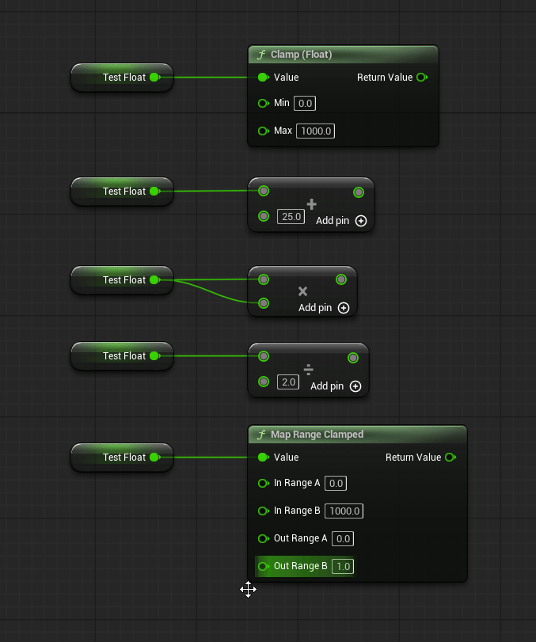

# Consolidate Variable Gets — Design

**Sweep v1.0.0 · User workflow**

## When to use Consolidate

A graph can become too repetitive when several local Gets reference the same variable. **Consolidate** makes a chosen Get the common source again, preserving the outgoing connections of the removed copies.

## Exact steps

<!-- Final IMAGE: docs/assets/media/consolidate-survivor.png -->
<figure class="doc-media" data-kind="image" data-media-id="consolidate-survivor">
  
  <figcaption>The right-clicked Variable Get survives while equivalent selected Gets transfer their connections to it.<strong>Capture instructions · Image:</strong> Show before/after Blueprint captures with three equivalent Get Health nodes selected; highlight the one right-clicked and retained, then show its combined outgoing wires.</figcaption>
</figure>

<figure class="doc-media doc-media-real">
  
  <figcaption>The clicked Get survives and inherits the connections from the selected equivalent Gets.</figcaption>
</figure>

1. Select **at least two equivalent pure Variable Gets** inside the **same Blueprint graph**.
2. Right-click the **Get you want to keep**, ensuring it was already part of that selection.
3. Choose **Sweep → Consolidate Selected Variable Gets**.
4. Inspect the surviving Get and its outgoing wires, including any reroute paths.
5. Compile and save the Blueprint or Undo if needed.

The **right-clicked Get is the survivor**. Its position is unchanged. You do not choose a new anchor from a dialog.

## Equivalent does not mean same label

Gets must reference the same underlying variable **and** have equivalent input context. Two `Get Health` nodes reading from different target objects must remain separate; a visual match alone would not preserve their meaning.

## What happens to reroutes?

Existing reroute nodes and their wire paths remain. Consolidate transfers connections from each redundant source Get to the survivor; it does **not** perform the orphaned-reroute cleanup used during Distribute.

## When the command is missing

You need at least two supported, equivalent Gets, and the clicked Get must belong to the selection. Differing target links, pin defaults, source variables, graphs or unsupported node types prevent consolidation. See [Equivalence](../../03-graph-integrity/equivalence/DESIGN.md).

---

For source-level behavior, [read Technical](TECHNICAL.md).
