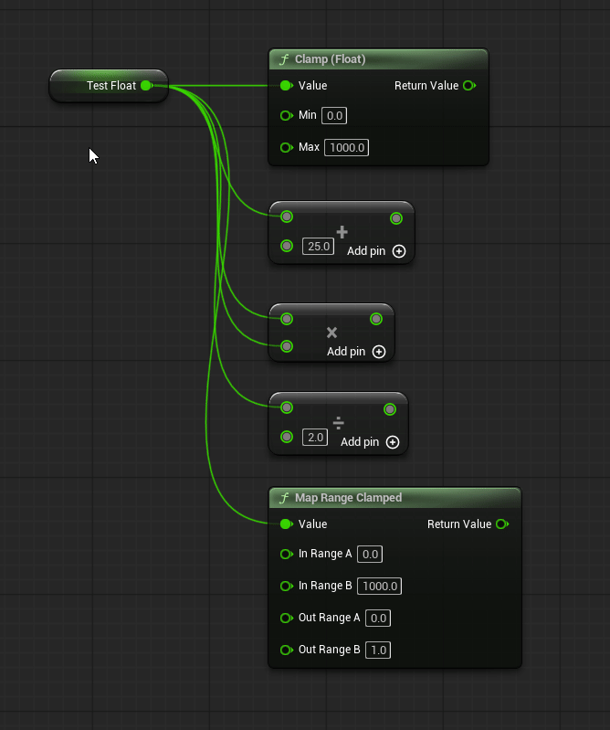

# Distribute Variable Gets — Design

**Sweep v1.0.0 · User workflow**

## When to use Distribute

A single pure Variable Get connected to distant calculations can create long crossing wires. **Distribute** trades one shared Get for local reads beside the nodes that need it, so each consumer's input is easier to trace.

## Exact steps

<!-- Final IMAGE: docs/assets/media/distribute-before-after.png -->
<figure class="doc-media" data-kind="image" data-media-id="distribute-before-after">
  
  <figcaption>Distribute creates local Variable Gets beside the nodes that consume a shared value.<strong>Capture instructions · Image:</strong> Capture the same Blueprint graph before and after distributing one Get Health into three local Gets, showing the old long wires, all three destination nodes and the new shorter wires.</figcaption>
</figure>

<figure class="doc-media doc-media-real">
  
  <figcaption>Sweep replaces a long shared wire with local Gets beside its actual consumer nodes.</figcaption>
</figure>

1. Find a supported pure Variable Get with **at least two actual terminal input pins** downstream. They may be reached through reroute nodes.
2. Right-click the Variable Get **node body**, rather than its pin.
3. Select **Sweep → Distribute Variable Get**.
4. Inspect the resulting local Gets to the left of their destination nodes.
5. Compile the Blueprint and use Undo if the layout does not fit your expectations.

If several inputs belong to the **same destination node**, Sweep uses **one local Get for that destination**, not one per wire. This avoids unnecessary duplicates around a single consumer.

## What happens to the original Get?

When its consumers successfully reconnect to newly created Gets and the old output has no live links left, the original Get is removed. A source still needed by some connection remains.

## Reroutes and formatting

Sweep follows chains of reroutes to find the terminal inputs, then removes reroutes that have become genuinely unused. Reroutes serving another live connection must remain. It does not move unrelated existing nodes or fully arrange the graph.

## If the command is absent

Check the number of terminal input pins, whether the node is a **pure Variable Get**, whether you're in a Blueprint K2 graph, and whether you right-clicked the node body. A connection to a reroute by itself is not a second terminal consumer.

---

For source-level behavior, [read Technical](TECHNICAL.md).
