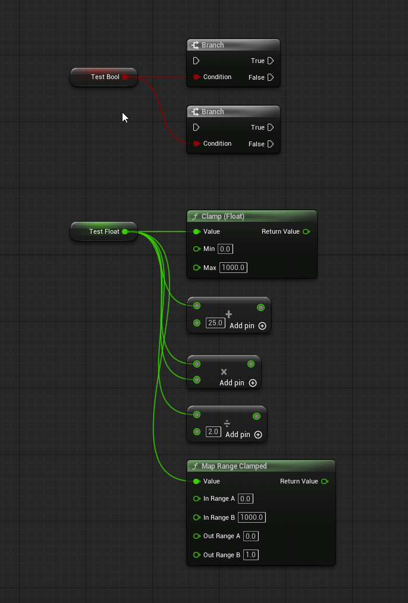

# Batch Operations and Selection — Design

**Sweep v1.0.0 · User workflow**

## Why selecting several nodes matters

If several long-wire Gets each need cleanup, you can distribute them in a single operation rather than opening a separate menu for each. Sweep can also consolidate a selection of equivalent Gets.

## Distribute multiple Gets

1. Select several **supported pure Variable Gets** in one Blueprint K2 graph.
2. Right-click **one of the selected Gets**.
3. Choose **Sweep → Distribute Selected Variable Gets** when any selected Get is eligible.
4. Eligible Gets are processed together in **one Undo transaction**.

Selected unsupported node types are ignored. A selected Get that does not have at least two terminal consumers is skipped rather than forced to change.

## The right-click selection behavior

<!-- Final IMAGE: docs/assets/media/selection-context.png -->
<figure class="doc-media" data-kind="image" data-media-id="selection-context">
  
  <figcaption>Sweep uses the graph selection captured before opening the context menu when the clicked Get was selected.<strong>Capture instructions · Image:</strong> Capture three selected pure Variable Gets in Blueprint, right-click on one of those selected nodes, and show Sweep &gt; Distribute Selected Variable Gets in the context menu.</figcaption>
</figure>

<figure class="doc-media doc-media-real">
  
  <figcaption>Several eligible selected Variable Gets can be distributed in one Undo transaction.</figcaption>
</figure>

Unreal may visibly collapse a multi-selection when its context menu opens. Sweep retains the most recent graph selection so its batch command can still operate on the intended nodes. If you right-click a Get that **was not in the selection**, Sweep treats it as a single-node action instead of using the previous selection.

## Consolidate a selection

Consolidation is stricter than batch distribution: select **two or more equivalent** Gets and right-click **the exact one to keep**. If the selected Gets are not all equivalent, the Consolidate command is not offered. Sweep does not silently merge only an arbitrary equivalent subset.

## If a batch doesn't change everything

Check which selected sources meet the specific operation's requirements. Mixed selection of Variable Gets and other node types is accepted for distribution; unsupported types are ignored. Undo reverses the completed changes as one editor transaction.

---

For source-level behavior, [read Technical](TECHNICAL.md).
