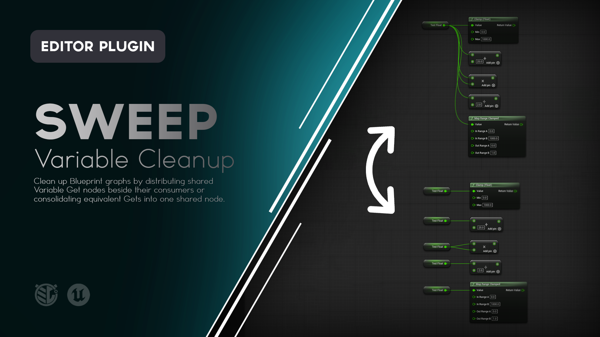

# Sweep Documentation

**Sweep v1.0.0 · Unreal Engine 5.8.0–5.8.3 · Win64 · Editor-only**

Sweep cleans up long Blueprint Variable Get wires by **distributing shared Gets beside their consumers** or **consolidating equivalent Gets into one chosen source**. The plugin works directly in native Blueprint K2 graphs and keeps the refactor reversible through Unreal’s Undo/Redo.

*Sweep helps turn long shared Variable Get connections into readable local sources, or combine equivalent Gets when a single shared source is clearer.*

## What can Sweep do?

- **Distribute Variable Gets** to reduce long graph-crossing wires, creating one local Get per destination node.
- **Consolidate equivalent Gets** into the Get you right-click, preserving their outgoing wire paths and reroutes.
- **Handle reroutes deliberately:** follow chains to actual consumers during Distribute, remove only unused reachable reroutes, and preserve reroutes during Consolidate.
- **Refactor selected Gets together**, preserving selections that Unreal may visually change when opening a context menu.
- **Undo or Redo** the change as one editor transaction, without introducing custom runtime systems.

## Get started in three steps

1. [Install Sweep](01-getting-started/install/DESIGN.md) for your supported Unreal Engine version.
2. [Try a first refactor](01-getting-started/first-use/DESIGN.md) in a disposable Blueprint K2 graph.
3. Learn when to [Distribute](02-operations/distribute/DESIGN.md) and when to [Consolidate](02-operations/consolidate/DESIGN.md).

## Choose the right operation

| Before | Action | After |
| --- | --- | --- |
| One pure Get has long outgoing wires to several consumers | **Distribute** | Local Gets sit beside destination nodes |
| Several equivalent Gets read the same variable/context | **Consolidate** | Their connections lead to the right-clicked surviving Get |

## Design versus Technical documentation

**Design** pages are user manuals: exact steps, screenshots, supported workflows, expected results and troubleshooting. **Technical** pages cover C++ ownership, K2 graph schemas, pin eligibility, context equivalence, transactions, graph modifications and known limits. Each topic has one of each, without copying the same paragraphs.

## Explore the manual

| Category | Topics | Overview |
| --- | ---: | --- |
| [01. Getting Started](01-getting-started/README.md) | 3 | Installation, purpose and first successful Blueprint refactor |
| [02. Operations](02-operations/README.md) | 4 | Distribute, consolidate and batch refactors |
| [03. Graph Integrity](03-graph-integrity/README.md) | 4 | Reroutes, equivalence, placement and Undo safety |
| [04. Implementation](04-implementation/README.md) | 2 | Source architecture, editor integration and graph algorithms |
| [05. Support and Troubleshooting](05-support/README.md) | 3 | Common questions, diagnostics, updates and issue reporting |

## Understand the current limits

Sweep v1.0.0 acts only on supported **pure Variable Get nodes in Blueprint K2 graphs**. It does not rewrite arbitrary functions or execution wires, reorganize the whole graph, or promise that every Blueprint will compile without review after a graph edit. Consolidation requires real variable identity **and matching target context**. Other graph editors are outside scope.

## Future directions and documentation status

The [Roadmap](ROADMAP.md) distinguishes the released v1.0.0 scope from noncommitted possibilities. The [Media Inventory](MEDIA_INVENTORY.md) lists real examples and placeholders with instructions for future screenshots/GIFs. The [Verification Matrix](VERIFICATION_MATRIX.md) records what still needs to be tested, and the [Documentation Audit](DOCUMENTATION_AUDIT.md) tracks remaining editorial gaps.

## Project and support

[Source repository](https://github.com/mippi-the-dork/Sweep) · [Releases](https://github.com/mippi-the-dork/Sweep/releases) · [GitHub Issues](https://github.com/mippi-the-dork/Sweep/issues)

**Documentation basis:** Sweep v1.0.0 README, descriptor and C++ source. Source review is not a claim of completed hands-on UE or live browser testing.
